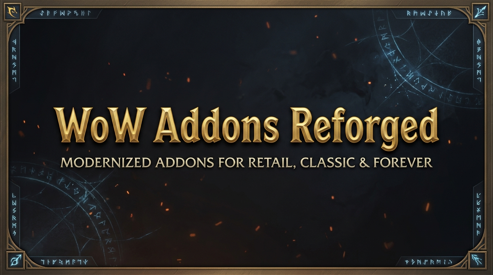

  

  # WoW Addons Reforged

  **Modernized, actively maintained World of Warcraft AddOns & Libraries for Retail, Classic, and WoW Forever.**

  
  
  

---

## AddOns & Libraries

### UI, Tracking & Economy
| Project | Description |
|---|---|
| **[Factionizer](https://github.com/WoW-Addons-Reforged/Factionizer)** | Multi-version Reputation, Renown, Paragon & Friendship tracker with a Modern Dark-Gold UI, live bag/bank/quest preview bars, interactive LDB tooltips, and faction guides. |
| **[GathererReforged](https://github.com/WoW-Addons-Reforged/GathererReforged)** | Modernized gathering tracker (Herbs, Mining, Treasures, Archaeology & 3D HUD). |
| **[CraftBench](https://github.com/WoW-Addons-Reforged/CraftBench)** | Modernized crafting & trade skill interface. |

### Combat, Chat, Social & Integration
| Project | Description |
|---|---|
| **[Parrot-Reforged](https://github.com/WoW-Addons-Reforged/Parrot-Reforged)** | Floating Combat Text of Awesomeness — updated for modern clients. |
| **[ElvUI_Embedder](https://github.com/WoW-Addons-Reforged/ElvUI_Embedder)** | Embeds Damage and Threat Meters (`Details!`, `Skada`, `Recount`, `Omen`, `TinyDPS`, Blizzard Damage Meter) cleanly into ElvUI Chat Panels. |
| **[GuildGreet-Extended](https://github.com/WoW-Addons-Reforged/GuildGreet-Extended)** | Extended Guild & Social Greeting Addon for WoW. |
| **[GGSocialState](https://github.com/WoW-Addons-Reforged/GGSocialState)** | LibDataBroker Addon for displaying Friends and Guild members. |
| **[Name2Chat](https://github.com/WoW-Addons-Reforged/Name2Chat)** | Adds your character's name or nickname automatically to chat messages. |

### Libraries
| Project | Description |
|---|---|
| **[LibBabble-Boss-3.0-Forever](https://github.com/WoW-Addons-Reforged/LibBabble-Boss-3.0-Forever)** | `LibBabble-Boss-3.0` maintained for WoW Forever (`16001`) with all 294 localized bosses and modern Lua/secret-value safety fixes. |

---

## Supported WoW Versions

Projects in this organization target one or more of the following World of Warcraft flavors:
- **Retail** (Midnight / The War Within)
- **Classic Progression** (Mists of Pandaria / Cataclysm / Wrath / TBC)
- **Classic Era & Anniversary**
- **WoW Forever (`16001`)**

---

## Support

If these addons improve your time in Azeroth, consider supporting ongoing maintenance and updates:

- **Website:** https://wow.goover.dev
- **Donate:** https://donate.goover.dev
